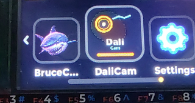
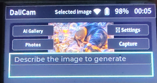
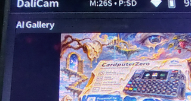
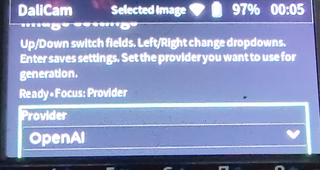
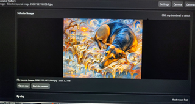
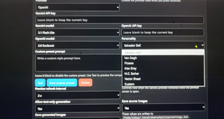

# DaliCam

DaliCam is a CardputerZero image workflow app for capturing photos, uploading test images, browsing galleries, and generating new images with Gemini and OpenAI image models.

It is designed to run **stand-alone on the device first**, with a WebUI companion on port `8080` for settings, gallery browsing, uploads, and remote capture.

## What DaliCam does

DaliCam currently provides:

- camera capture on the device
- on-device image preview using a canvas/raw-buffer render path
- prompt-driven image generation and editing
- personality preset selection, including a custom preset workflow
- model selection for Gemini and OpenAI image models
- galleries for camera photos, generated images, and uploads
- a WebUI for settings and image management
- image upload from the browser for testing and comparison
- remote capture from the WebUI
- per-image gallery actions in the WebUI
- day-grouped galleries in the WebUI

## Quick start

1. Launch DaliCam on the device.
2. Open the WebUI in a browser at:
   - `http://<device-ip>:8080`
3. Set your Gemini or OpenAI API key.
4. Choose a model and personality preset.
5. Capture, upload, or select an image.
6. Add an optional prompt and generate.

If you leave the prompt empty, DaliCam uses the selected preset by itself.

Custom preset text can be saved, reused, or deleted from the settings screen and WebUI.

## Media

Demo video: [YouTube Shorts](https://www.youtube.com/shorts/sAD5fTfU66A)

| Launcher | Main screen | AI Gallery |
| --- | --- | --- |
|  |  |  |
|  |  |  |

These screenshots were captured from the current device and WebUI build.

## Device user guide

### Main screen

The main screen is the primary workflow screen.

It includes:

- a prompt box
- a thumbnail preview of the current or last selected image
- a compact header showing the app name, current model, and preset
- Settings and Capture buttons
- AI Gallery and Photo Gallery buttons

### What the prompt box does

The prompt box is for **optional extra instructions**.

- If you type text, DaliCam uses it as extra guidance for image generation.
- If you leave it blank, DaliCam uses the selected preset only.
- It is not a chat box and does not require a command word.
- Press **Enter** to submit the current prompt.

### Image workflow on the device

Typical flow:

1. Capture a photo, upload a test image in the WebUI, or choose a gallery image.
2. The selected image stays on the thumbnail.
3. Type an optional prompt.
4. Press **Enter** to generate.
5. The resulting image is saved and becomes available in the galleries.

### Device galleries

The device has two gallery modes:

- **AI Gallery** — generated images
- **Photo Gallery** — camera captures and uploaded images

Gallery controls:

- **F** or **Up**: move up
- **X** or **Down**: move down
- **Enter**: select the highlighted image for editing
- **D**: delete the highlighted image
- **Y / N**: confirm or cancel delete
- **Esc**: go back

The galleries are intentionally simple: one image at a time, with the selected image returning to the prompt screen.

### Capture confirmation

After a capture, DaliCam asks for confirmation before continuing:

- **Y** keeps the captured photo and uses it
- **N** saves the captured frame to the gallery and returns to preview mode
- **Esc** cancels the preview flow

## WebUI user guide

Open the WebUI at:

- `http://<device-ip>:8080`

### WebUI home page

The WebUI home page contains:

- Gemini API key field
- model selector
- personality preset selector
- prompt box
- Generate button
- Remote capture button
- upload area
- latest image preview

### WebUI prompt box

The WebUI prompt box behaves the same way as the device prompt box:

- enter extra instructions if you want them
- leave it blank to use the preset only
- press Generate to continue
- you will be asked to confirm before generation starts

### WebUI galleries

The WebUI now uses galleries instead of simple viewer pages.

There are three gallery pages:

- Camera gallery
- Generated gallery
- Uploads gallery

Each gallery is grouped by **day** so the page stays readable.

Each image card includes:

- a thumbnail
- the file name
- the time it was saved
- **Select for editing**
- **Download**
- **Delete**

### Remote capture

The WebUI includes a **Remote capture** button so you can take a photo without holding the device.

When clicked, it:

1. asks for confirmation
2. captures a photo on the device
3. saves it into the camera gallery
4. refreshes the WebUI so the new photo is available immediately

## Presets and models

### Supported image models

Current supported Gemini image models include:

- `gemini-nano-banana-2.1`
- `gemini-3.1-flash-lite-image`
- `gemini-3-pro-image`

### Included personality presets

Current presets include:

- Salvador Dali
- Van Gogh
- Picasso
- Alex Grey
- M.C. Escher
- Vector Sheet

The preset selector is available on both the device and the WebUI.

## Storage layout

DaliCam stores app data under the user profile on the SD-backed filesystem by default.

Typical paths:

- `~/.local/share/DaliCam/settings.ini` — saved settings
- `~/.local/share/DaliCam/input/` — camera captures
- `~/.local/share/DaliCam/generated/` — Gemini output images
- `~/.local/share/DaliCam/uploads/` — browser-uploaded images
- `~/.local/share/DaliCam/temp/` — temporary render files
- `~/.local/share/DaliCam/logs/` — runtime logs

## Installation

### Recommended: CardputerZero App Store

DaliCam is packaged for the CardputerZero App Store, with store metadata, screenshots, and asset paths kept in sync with the current release build so it is ready for upload.

### Developer install

If you are working from source, the repository includes the usual CardputerZero workflow build and deploy path.

Typical build:

```bash
cmake --workflow --preset cp0-cross-package
```

If your local CMake is older than the preset minimum, you will need a newer CMake release to run the package workflow.

Typical deploy:

```bash
REMOTE_USER=pi REMOTE_HOST=192.168.1.10 ./deploy.sh
```

Adjust the target host and credentials for your device.

## Updates

DaliCam keeps user data outside the package itself, so normal package updates should preserve:

- saved settings
- captured images
- generated images
- uploaded images

If you want a full reset, remove the `~/.local/share/DaliCam/` data directory on the device.

## Project goals

The current direction is to keep DaliCam simple, device-first, and practical:

- the device should work stand-alone as much as possible
- the WebUI should mirror the device workflow instead of replacing it
- galleries should make it easy to compare camera, uploaded, and generated images
- the prompt workflow should stay quick and direct

## Future ideas

These are the next ideas being considered for later work:

- custom preset text box in the WebUI
- save a custom preset into the dropdown list
- more personality presets
- on-device gallery polish
- bulk select in the WebUI
- better photo management tools
- preview refresh interval control

## Notes

- The preview on the device now uses a canvas/raw-buffer path, which fixed the mosaic-style rendering issue.
- The latest selected, captured, uploaded, or generated image remains available as the active thumbnail.
- Generation may take up to about a minute depending on the selected model and provider.
- The WebUI is meant for testing, administration, and image management while still keeping the device usable on its own.
- The repository is MIT licensed.
